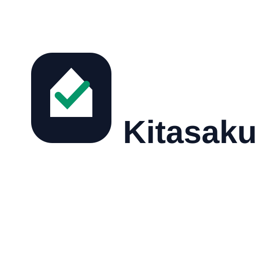

  

<h3 align="center">Atur uang keluarga, bareng-bareng.</h3>

  Kitasaku membantu satu rumah tangga membagi setiap rupiah sejak hari gajian, 
  lalu melihat bersama apakah rencananya berjalan.

  <a href="https://github.com/fresp/kitasaku-releases/releases/latest"><b>Unduh versi terbaru</b></a>

  
  
  

---

Repo ini hanya berisi **file APK Kitasaku untuk Android**. Kitasaku belum ada di Play Store,
jadi aplikasinya dipasang langsung dari halaman [Releases](https://github.com/fresp/kitasaku-releases/releases).

## Cara pasang

1. **Unduh APK.** Buka [versi terbaru](https://github.com/fresp/kitasaku-releases/releases/latest)
   dari HP, lalu di bagian **Assets** ketuk file `kitasaku-x.y.z.apk`. Ukurannya sekitar 110 MB,
   sebaiknya pakai Wi-Fi.
2. **Izinkan pemasangan.** Saat membuka file, Android akan minta izin "Instal aplikasi tidak
   dikenal" untuk browser atau aplikasi File. Izinkan sekali saja, lalu kembali.
3. **Pasang.** Ketuk **Instal**. Kalau Play Protect memperingatkan aplikasi yang tidak dikenal,
   pilih **Tetap instal**. Ini wajar untuk aplikasi di luar Play Store.
4. **Masuk.** Buka Kitasaku dan masuk dengan akun Google.
5. **Gabung ke ruang keluarga.** Orang pertama memilih **Buat Baru**. Pasangan memilih
   **Gabung** lalu memasukkan kode undangan (mis. `ABC-123`) atau memindai QR-nya. Kode ada di
   **Profil > Ruang Keluarga** di HP orang pertama, lengkap dengan tombol **Salin Kode**.

## Update

Mulai versi **1.1.0 (build 18)**, Kitasaku memberi tahu sendiri saat ada versi baru:

| Yang muncul | Artinya | Yang perlu dilakukan |
|---|---|---|
| Banner **Versi baru siap dipakai** di Beranda | Perbaikan kecil sudah terunduh otomatis | Ketuk **Muat ulang**, atau tutup dan buka lagi aplikasinya |
| Lembar **Kitasaku x.y.z tersedia** | Ada APK baru | Ketuk **Unduh & pasang**, atau **Nanti saja** |
| Layar **Perlu update dulu** | Versi ini sudah tidak bisa dipakai | Ketuk **Unduh**, pasang, lalu buka lagi |

Update dipasang **di atas** versi lama. Jangan hapus aplikasi dulu: data tersimpan di server,
jadi tetap aman, tapi kamu tidak perlu masuk ulang kalau langsung menimpa.

## Pertanyaan umum

**"Aplikasi tidak terpasang" atau "konflik dengan paket yang ada".**
APK yang terpasang ditandatangani dengan kunci yang berbeda, biasanya karena berasal dari build
uji coba. Hapus Kitasaku lama, lalu pasang APK dari halaman ini. Data tidak hilang, cukup masuk
lagi dengan akun Google yang sama.

**Tombol unduh di dalam aplikasi tidak melakukan apa-apa.**
Buka [halaman Releases](https://github.com/fresp/kitasaku-releases/releases/latest) langsung
dari browser HP dan unduh dari sana.

**Apakah APK ini aman?**
Pasang Kitasaku hanya dari halaman ini. Setiap versi ditandatangani dengan kunci yang sama,
jadi Android menolak menimpa aplikasi dengan APK dari sumber lain.

**Apakah ada versi iPhone?**
Belum. Kitasaku saat ini hanya untuk Android.

## Riwayat versi

| Versi | Build | Isi utama |
|---|---|---|
| [1.3.0](https://github.com/fresp/kitasaku-releases/releases/tag/v1.3.0) | 20 | Tambah pokok untuk tanggungan yang bertambah, uang masuk langsung tercatat di rekening |
| [1.2.0](https://github.com/fresp/kitasaku-releases/releases/tag/v1.2.0) | 19 | Bayar beberapa tanggungan sekaligus, Detail Pembayaran per batch di Riwayat |
| [1.1.0](https://github.com/fresp/kitasaku-releases/releases/tag/v1.1.0) | 18 | Kolaborasi Ruang Keluarga, notifikasi tanggungan, pemberitahuan versi baru |

Catatan lengkap tiap versi ada di halaman [Releases](https://github.com/fresp/kitasaku-releases/releases).
